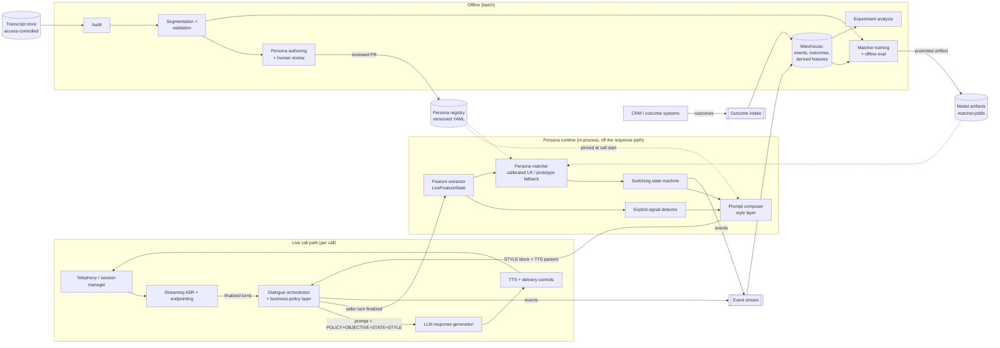
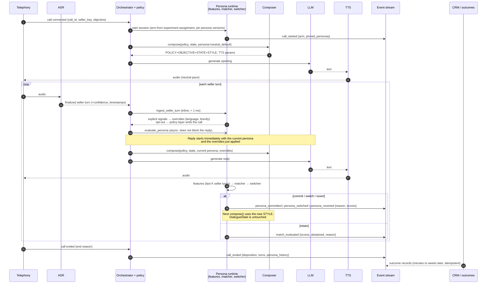

# 02 · End-to-end architecture

*Deliverable 3, plus brief §1.3 and §6.*

## Boundaries: reuse, change, introduce

| Kind | Components |
|---|---|
| **Reuse unchanged** | Telephony / call-session manager, streaming ASR, TTS engine, LLM serving, CRM / disposition systems |
| **Change (small hooks)** | Dialogue orchestrator: (1) publish each finalized seller turn to the persona runtime, (2) read the current STYLE block + TTS parameters before each agent turn, (3) emit events. Business-policy layer: expose approved answers per objective |
| **Introduce** | Behavioural feature extractor, persona matcher, switching state machine, persona registry, prompt composer (style layer), event/outcome schemas, offline analytics (audit, segmentation, matcher training), experiment assignment + analysis |

## Component diagram

## Component responsibilities

| # | Component | Inputs → outputs | Sync / async | State owned | Failure behaviour | Code |
|---|---|---|---|---|---|---|
| 1 | Telephony / session manager | Dial, media → audio streams, call end reason | Real-time | Call lifecycle | Existing behaviour | existing |
| 2 | ASR + endpointing | Audio → partial and **finalized** turns, confidence, timestamps | Streaming | None | Low confidence → turn flagged; persona runtime ignores it as evidence | existing; `endpointing_patience_ms` comes from persona |
| 3 | Turn-event processor | Finalized turns → `ingest_seller_turn` (inline) + `evaluate_persona` (async) / `on_agent_turn` | Inline < 1 ms + async | Turn index | If the hook fails, VANI continues in the current style | `orchestration/session.py` |
| 4 | Feature extractor | Turns → feature vector (whole prefix or last-K-seller-turn window) | Async, < 1 ms | `LiveFeatureState` (per call, in memory) | Silence / low-confidence turns produce no evidence | `matching/early_features.py`, `features/transcript.py` |
| 5 | Persona matcher | Features + context → scores, evidence, abstain flag | Async, target < 5 ms | Stateless (model loaded once) | Exception or timeout → empty scores → switcher retains the current persona; `matcher_fallback` event | `matching/matcher.py` |
| 6 | Persona registry | YAML → validated persona configs | Load at process start; versions pinned per call | Immutable cache keyed by (id, version) | Invalid persona → fails at load (CI), never at call time | `personas.py` |
| 7 | Orchestrator + policy layer | Dialogue state, objective policy, style → prompt | Sync (existing) | **`DialogueState`**: objective, stage, facts, commitments, consent, language | Existing | `orchestration/dialogue_state.py` |
| 7a | Switching state machine | Match results → retain / commit / switch / revert | Async | `SwitchState` (per call) | Missing scores → retain | `switching/state_machine.py` |
| 7b | Prompt composer | Policy + state + persona + overrides → layered prompt + TTS params | Sync, pure function, < 1 ms | None | Persona missing → neutral | `orchestration/composer.py` |
| 8 | LLM response generation | Layered prompt → text | Sync (existing) | None | Existing fallback; persona adds no extra LLM call | existing |
| 9 | TTS + delivery | Text + `tts_rate`, pauses → audio | Streaming (existing) | None | Unsupported params → defaults | existing |
| 10 | Event logger / outcome collector | Events, outcomes → stream / warehouse | Async, at-least-once | None (append-only) | Buffer and retry; drops never block the call | `events.py`, `schemas/call_event.schema.json`, `schemas/outcome.schema.json` |
| 11 | Offline analytics | Transcripts, events, outcomes → reports, segments, models | Batch | Versioned artifacts | Bad runs never auto-deploy (promotion gate) | `audit.py`, `segmentation/`, `matching/train.py`, `experiment/` |

## Runtime sequence

**Two phases per seller turn** (`CallSession.ingest_seller_turn` and `CallSession.evaluate_persona`):

- **Inline phase.** Lexical tagging, explicit requests and opt-out run before the next reply is composed. They take under a millisecond, and a direct request must shape the very next reply.
- **Async phase.** Inferred persona changes run off the response path. If evaluation has not finished when the next reply starts, that reply uses the previous persona. The inferred style is then at most one turn late, and a reply is never delayed.

## Latency budget (design targets, not measurements)

| Step | Target | On the response path? | Basis |
|---|---|---|---|
| Lexical tagging + explicit signals (inline phase) | < 1 ms | **Yes** | Precompiled regexes over one utterance |
| Feature extraction per seller turn | < 1 ms | No | Pure Python over tens of turns. Measure with a benchmark in Phase 4 |
| Matcher scoring | < 5 ms p99 | No | One logistic regression on ~20 features. Measure in shadow |
| Switch decision | < 0.1 ms | No | Arithmetic |
| Prompt composition | < 1 ms | **Yes** | String assembly; replaces an existing step |
| Extra LLM tokens from STYLE block | ≈ 100–200 prompt tokens | **Yes** | Measure the effect on time-to-first-token. Precompile per-persona prompts if it matters |
| **Total added to response path** | **≤ 2 ms + STYLE-token effect** | | Acceptance: p95 response latency in shadow and treatment no worse than control + 50 ms (guardrail, tunable) |

**Dev-machine microbenchmark (2026-10-09).** Single Python process, this repo, 300 simulated calls × 20 turns. The logistic matcher was trained on *synthetic* data with ~13 features. These are indicative only, **not** production measurements:

| Operation | p50 | p99 |
|---|---|---|
| `ingest_seller_turn` (inline) | 0.02 ms | 0.10 ms |
| `compose_next` (inline, incl. event validation) | 0.08 ms | 0.11 ms |
| `evaluate_persona` with prototype scorer (async, incl. events) | 0.14 ms | 0.21 ms |
| Logistic matcher `match()` (calibrated, 3 classes) | 1.04 ms | 1.80 ms |

Two optimizations came out of this benchmark:
- Compiled JSON Schema validators cut event emission from ~3 ms to < 0.1 ms.
- A dict-based single-row `transform_one` cut the logistic matcher from ~13 ms to ~1 ms.

Phase 4 must re-measure on production hardware, including the effect of STYLE tokens on LLM time-to-first-token, which has not been measured.

## Reliability rules

- **Fail toward the current or neutral style.** Every failure of the persona runtime leaves VANI speaking as it already was. Failure in the first turns means VANI speaks exactly as today.
- **Timeouts.** The orchestrator never waits on the persona runtime. In a separate-service deployment, use a 30 ms deadline (`matcher_timeout_ms`, tunable) and a circuit breaker: after N consecutive failures, stop calling for that process and log `matcher_fallback`.
- **No per-turn LLM classification.** The matcher is a small model. An LLM-based objection tagger may be added only if it is measured to improve matching enough to justify its latency and cost. It would then use a schema-validated output, with the lexicon tagger as fallback.
- **Config safety.** Personas are validated (JSON Schema + policy lint) in CI and at process start. A call pins the persona versions it started with, so a deploy never changes a persona mid-call.
- **Monitoring.** Dashboards and alerts for:
  - matcher latency (p50/p99) and error rate,
  - fallback rate and abstention rate,
  - switch rate per call and revert rate,
  - persona mix by campaign and language,
  - response latency by arm,
  - cost per call (STYLE tokens).
