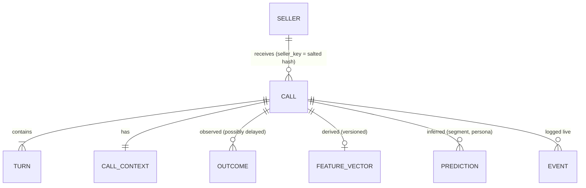

# 03 · Historical-call analysis and segmentation

*Deliverable 4, plus brief §2.* Code: `src/vani_persona/{ingest,features,segmentation}/`, `audit.py`.

## 1. Data sources and how each is used

| Source | Used for | Required? |
|---|---|---|
| Speaker-separated transcripts | All behavioural features | **Yes** |
| Turn timestamps | Response latency, overlap/interruption, duration (context only) | Optional; features become `null` without them |
| ASR confidence per turn | Excluding unreliable turns from evidence; data-quality strata | Optional |
| Audio / acoustic features | Speech rate, pitch variability (future) | **Not required.** Use only if legally permitted |
| Disposition + termination reason | Outcome (normalized `DispositionClass`), technical-failure exclusion | **Yes** |
| Downstream conversion (CRM) | Secondary outcome, validates bot-reported dispositions | Strongly recommended |
| Campaign, call objective, script/agent version, category, time | Confounders: residualization strata and outcome-model covariates | **Yes** (campaign + objective at least) |
| Existing prompts / objection taxonomy | Seeding lexicons and approved answers | Helpful |

## 2. Canonical record



- **Observed** (`canonical.py: CallRecord`): turns (speaker, text, timestamps, ASR confidence, interruption flag), context, outcome, data-quality flags. This is what happened.
- **Derived** (`features/transcript.py`): deterministic functions of observed data, versioned with the code.
- **Inferred** (segments, persona predictions): stored **separately**, never on `CallRecord`, always with a model version.

Rules that keep inference honest:
- A short call is never labelled "impatient". Duration is `role: context` and is excluded from clustering.
- Calls with fewer than 3 seller turns are excluded from *discovery*, not labelled.
- A failed outcome is never treated as a wrong style: historically every call used the same style.

The PII handling is described in `docs/13-privacy-security-responsible-adaptation.md`. Redaction runs at ingest, before features are computed. Seller IDs are salted hashes.

## 3. Behavioural feature schema

The canonical source is `src/vani_persona/features/registry.py`, and the generated contract is `schemas/features.schema.json`. All features are computed from **seller** turns by the same function offline and live (train/serve parity).

| Feature | Category | Definition / extraction | Sources | Hist./live | Reliability | Main failure modes |
|---|---|---|---|---|---|---|
| `seller_mean_tokens` | communication preference | Mean whitespace tokens per seller turn | transcript | both | medium | Devanagari vs romanized tokenization; ASR word drops |
| `short_reply_ratio` | turn-taking | Share of seller turns ≤ 3 tokens | transcript | both | medium | Backchannels ("haan", "ji"); answers to yes/no questions |
| `long_reply_ratio` | engagement | Share of seller turns ≥ 15 tokens | transcript | both | medium | ASR merging turns |
| `question_rate` | engagement | Share of seller turns with "?" or a question word | transcript | both | low | ASR rarely emits "?"; "kya" as filler |
| `clarification_rate` | communication preference | Lexicon: "kya bola", "samjha nahi", "phir se"… | transcript | both | medium | Often line noise or TTS clarity, not preference |
| `brevity_request_rate` | communication preference | Lexicon: "jaldi bolo", "point pe aao"… | transcript | both | high | Rare, so a sparse signal |
| `time_pressure_rate` | engagement | Lexicon: "busy hoon", "baad mein", "driving"… | transcript | both | medium | "baad mein" in unrelated sentences (**seen on synthetic data**) |
| `objection_{price,trust,not_interested,already_have}_rate` | objection | Category lexicons | transcript | both | low–high | A neutral price question ≠ a price objection |
| `info_request_rate` | objection | "details bhejo", "whatsapp"… | transcript | both | medium | Polite deferral vs real interest |
| `affirmation_rate` | progression | "haan", "ji", "theek hai", "ok"… | transcript | both | medium | "ji" is politeness, not agreement |
| `engagement_slope` | progression | OLS slope of tokens over seller turn order (≥ 3 turns) | transcript | both | low | Driven by the agent's question type |
| `response_latency_median_ms` | pace | Median gap from agent end to seller start | timestamps | both | medium | Includes ASR endpointing delay |
| `overlap_rate` | turn-taking | Seller starts before the agent ends (or barge-in flag) | timestamps / telephony | both | medium | Echo / crosstalk |
| `log_mean_tokens` | communication preference | log(1 + mean tokens per seller turn) | transcript | both | medium | Tokenization differences |
| `resistance_rate` | objection | Share of seller turns with **any** objection (union of the four objection lexicons) | transcript | both | medium | Inherits lexicon false positives |
| `rush_rate` | engagement | Share of seller turns with time pressure **or** a brevity request | transcript | both | medium | "baad mein" in unrelated sentences |
| `devanagari_ratio`, `hindi_function_ratio`, `code_switch_rate` | **language** | Script share; function-word ratios | transcript | both | high / medium / low | Reflects ASR output script; noun-only English insertions missed |
| `duration_s`, `n_seller_turns` | **context** | Call length; turn count | timestamps / transcript | both | high | Not behaviour: drops, wrong numbers, quick success |

**Roles after the PS07 audit** (`registry.py: role`):
- **Clustered (`segment`):** `short_reply_ratio`, `question_rate`, `affirmation_rate`, `log_mean_tokens`, `resistance_rate`, `rush_rate`.
- **Descriptive only (`detail`):** the individual objection, time-pressure, brevity, info-request and clarification rates; `seller_mean_tokens`, `long_reply_ratio`, `engagement_slope`; latency and overlap.

Why:
- Each individual lexicon rate fires in < 11% of calls. Zero-inflated dimensions made the first real run fail every stability gate.
- Some features were redundant: `long_reply_ratio` vs `seller_mean_tokens` r = 0.77.
- Direct requests (brevity, clarification) are rare and are handled by overrides.
- Timestamps were snapped, so latency and overlap were excluded (`exclude_features`).

The full run history is in `findings/discovery_log.md`.

**Transcript-only fallback.** Every `segment` feature except latency and overlap needs only text. If the audit shows no timestamps, those two are dropped automatically (`select_segment_features`: missing > 30% → dropped and reported).

**Lexicon precision is a hard gate.** The synthetic run already showed false positives. On real PS07 calls, the bare filler "matlab" was 75% of all clarification hits and ~1/12 genuine in a spot check. It was removed, keeping only its question forms, and that removal changed the discovered segments. Before persona approval:
1. Hand-label 200 random seller turns per lexicon category.
2. Require precision ≥ 0.8 (tunable).
3. Remove or contextualize offending phrases.

## 4. Segmentation method

| Method | Pros | Cons | Verdict |
|---|---|---|---|
| Rule-based segments | Fully interpretable, no data needed | Encodes our assumptions rather than discovering structure; thresholds arbitrary | Used only for **hypotheses** and for explicit signals |
| Clustering on normalized interpretable features (GMM / k-means) | Interpretable centroids; probabilistic membership (GMM); cheap; stable to validate | Assumes roughly elliptical clusters; sensitive to scaling | **Recommended core** |
| Embedding clustering (sentence embeddings of seller turns) | Captures semantics beyond lexicons | Clusters on *topic* and language rather than behaviour; hard to explain; embeddings drift with model versions | Not for v1. Possible later as an objection-tagging aid |
| Hybrid: clusters + expert review | Statistical structure + business meaning | Needs reviewer time | **Recommended overall** |

**Recommendation: the hybrid approach** (`segmentation/pipeline.py`):

1. **Eligibility.** Exclude technical failures and calls with < 3 seller turns, < 3 seller tokens, or mean ASR confidence < 0.6. The token bar is deliberately low: a bar of 8 tokens dropped most "terse" synthetic calls, and that would bias discovery against exactly the sellers who need a brief style.
2. **Feature selection.** Keep `role: segment` features with ≤ 30% missing and non-zero variance, minus `exclude_features` (with reasons) from the audit.
3. **Residualization.** Median-impute and winsorize at 1/99%. Then subtract per-stratum means for campaign × objective × lead type × language, backing off to coarser strata when a stratum has < 50 calls. Then standardize. Clusters therefore describe behaviour *relative to comparable calls*, not campaign mix.
4. **Clustering.** Diagonal-covariance GMM for k = 3…6 (5 inits), with k-means fitted for agreement checking.
5. **Validation gates** (below). Choose the passing k with the best silhouette; ties go to fewer segments.
6. **Description.** Distinctive features (|mean z| ≥ 0.5), raw medians, language/disposition mix, proxy check.
7. **Human review** with the checklist in the report. Approved segments become persona candidates.

**Why language is excluded from clustering.** Language preference is directly observable and actionable without clustering: VANI mirrors the seller. Clustering on it would produce "the Hindi persona", which is a stereotype and not a communication need. Language features are still reported per segment, and a Cramér's V proxy check flags any segment that tracks language, category or campaign (V > 0.5).

## 5. Choosing k and validating segments

| Criterion | Measure (in `segmentation/validate.py`) | Default gate (tunable) |
|---|---|---|
| Sufficiently populated | Smallest segment share | ≥ 5% |
| Reproducible | Mean ARI of bootstrap refits vs reference labels | ≥ 0.7 |
| Stable over time | ARI between early-period and late-period models, scored on the late period | ≥ 0.6 |
| Not redundant | Minimum RMS distance between centroids (standardized) | ≥ 0.5 |
| Separated | Silhouette | ≥ 0.05 (behavioural data rarely clusters crisply; human review compensates) |
| Method-robust | GMM vs k-means ARI | Reported; < 0.5 → treat with caution |
| Robust to noisy transcripts | Re-run excluding calls with mean ASR confidence < 0.8; ARI vs full run | Phase 2 manual check |
| Interpretable | Reviewers can name the behaviour and recognise it in 20 random transcripts per segment | Human checklist |
| Useful | Matcher can predict it from ≤ 3 seller turns (doc 06) **and** it maps to a distinct, actionable style | Phase 3 |
| Outcome-relevant | Confounder-adjusted outcome rate differs from the other segments, or the style need is distinct | Descriptive; reported, not required |

**Rejection criteria.** Drop or merge a segment if any of these holds:
- it fails a gate;
- reviewers cannot describe it behaviourally;
- it is a proxy for language, category or campaign (V > 0.5 without a behavioural explanation);
- its recommended style is not materially different from another persona's;
- the matcher cannot recognise it early (recall < 0.5 at 3 seller turns).

If fewer than 3 segments survive, the report says so (`Result: NO persona library supported`). The project then proceeds with explicit-signal overrides only, which still deliver language and brevity adaptation.

## 6. Controlling for confounders

| Confounder | Control |
|---|---|
| Call purpose / campaign | Residualization strata; covariate in the outcome model; segment analysis within objective |
| Lead quality (PS07 `redis_bucket`) | Residualization stratum (`lead_type`); outcome covariate; proxy check (V = 0.12) |
| Seller category | Outcome-model covariate; proxy check |
| Language / region | Residualization stratum; language excluded from clustering; proxy check |
| Time of day | Outcome-model covariate (`hour`) |
| Prior intent beyond the lead bucket | Unobserved historically. Only randomization (A/B) controls it. Never interpret segment outcome gaps as style effects |
| Agent / script version | Outcome-model covariate; temporal-stability gate catches version shifts |
| Duration / incomplete transcripts | Duration excluded from clustering; minimum-turn eligibility; incomplete calls excluded and counted |
| Telephony / ASR errors | Technical-failure exclusion; ASR-confidence filter; noisy-transcript robustness check |

**Outcome association** (`segmentation/outcomes.py`) reports, per segment, a g-computation (standardized) rate:
- fit a logistic model of the outcome on segment plus confounders,
- set every call's segment to *s*,
- average the predictions,

with a 95% bootstrap CI. The interpretation is fixed: all historical calls used the same style, so a low adjusted rate means *the uniform style underperforms for this segment*. That is where adaptation has headroom. **It is not evidence that any persona will fix it.** Only the A/B test can show that.

## 7. Results on the PS07 export (run `seg-63b6bc47e6`)

- **Data.** 12,354 calls; 8,722 eligible.
- **Result.** k = 3 passes every gate: bootstrap ARI 1.00, temporal ARI 1.00, silhouette 0.18, smallest segment 16.2%.
- **Proxy check.** Cramér's V ≤ 0.12.

| Segment | Share | Behaviour | Adjusted meeting rate |
|---|---|---|---|
| 0 receptive | 56.7% | no distinctive features | 40.5% |
| 1 objection-raising | 27.0% | `resistance_rate` +1.29 | 18.8% |
| 2 time-pressed | 16.2% | `rush_rate` +1.64 | 15.9% |

Caveats:
- The method is sensitive: GMM vs k-means ARI is 0.22.
- The segments partly overlap the outcome definition.
- The transcript subset has a higher meeting rate than all bot calls (22.1% vs 11.5%).

Details are in `findings/discovery_log.md` and the generated reports.

## 8. Outputs

| Output | Location | Commit? |
|---|---|---|
| Data audit | `docs/findings/data_audit.md` | Yes (aggregates only, tested to contain no transcript text) |
| Segmentation report | `docs/findings/segmentation_report.md` | Yes |
| Outcome association | `docs/findings/outcome_association.md` | Yes |
| Segment model | `artifacts/segmentation.joblib` | No (gitignored) |
| Prototypes to seed persona YAML | `artifacts/persona_prototypes.yaml` | No; copied into reviewed persona files |
| Call → segment labels | `data/derived/segments.csv` | No (gitignored) |

Run:

```bash
# PS07 export (multi-table, read in place from the repo root)
.venv/bin/python -m vani_persona.audit . --source ps07
.venv/bin/python -m vani_persona.segmentation.pipeline . --source ps07
# any other single-table CSV/JSONL export
.venv/bin/python -m vani_persona.audit data/raw --columns-only   # then edit config/column_mapping.yaml
.venv/bin/python -m vani_persona.segmentation.pipeline data/raw
```
