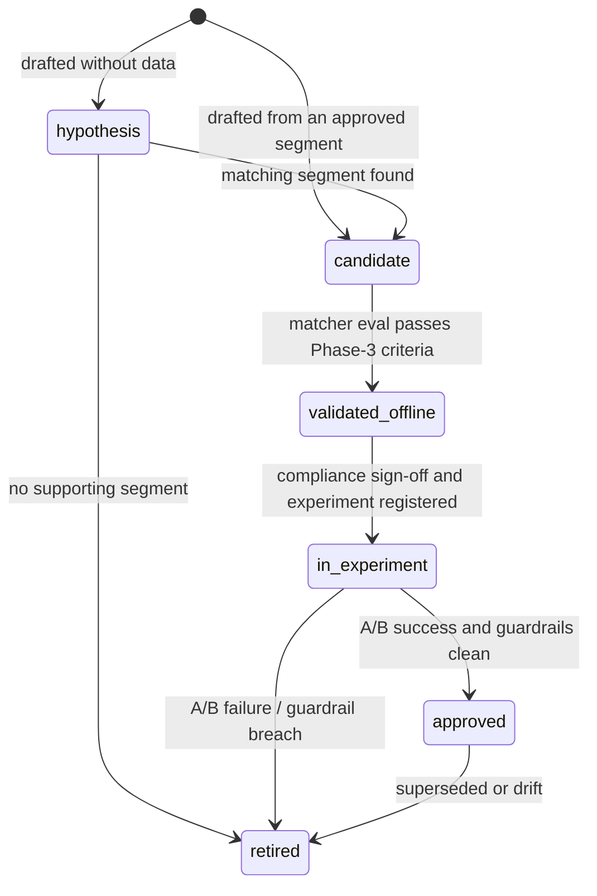

# 05 · Persona configuration

*Deliverable 6, plus brief §3.4.* Schema: `schemas/persona.schema.json`. Loader, lint and registry: `src/vani_persona/personas.py`.

## What lives where

The brief asks for stable definitions, runtime parameters, language templates, objective-specific instructions, objection policies, matching criteria, switching rules and evaluation metadata to be kept apart. These are split by **who owns them and how often they change**:

| Concern | Location | Owner | Changes when |
|---|---|---|---|
| Stable persona definition (summary, distinctive features, evidence, limitations) | persona YAML `definition` | Data science + reviewer | Re-segmentation |
| Runtime style parameters (tone, pace, length, turn-taking, re-engagement) | persona YAML `style` | Conversation design | Style iteration (new version) |
| Objection-handling *moves* | persona YAML `style.objection_handling` (closed vocabulary) | Conversation design | Style iteration |
| Objection-handling *content* (approved answers, verification route) | `config/objectives/<objective>.yaml` | Business + compliance | Policy change |
| Objective-specific instructions (steps, allowed actions, forbidden list, mandatory disclosures) | `config/objectives/<objective>.yaml` | Business + compliance | Policy change |
| Language templates | The language axis: `style.language.policy` (mirror) + `StyleOverrides.language` + `ObjectivePolicy.supported_languages`. Localized approved answers are keyed per language when needed | Localization | New language |
| Matching criteria | persona YAML `matching` (segment id, prototype) + `artifacts/matcher.joblib` | Data science | Retraining |
| Switching rules | `config/thresholds.yaml` `switching` (global) + `switching.threshold_overrides` (per persona) | Data science | Tuning |
| Evaluation metadata | persona YAML `evaluation` + `status` | Experiment owner | Lifecycle transitions |

Personas deliberately contain **no** facts, offers or objective logic. That separation lets a persona be A/B-tested without re-reviewing policy, and lets policy change without touching personas.

## Example configuration (abridged)

The full file is `personas/time_pressed.yaml`, a data-backed candidate from run `seg-63b6bc47e6`.

```yaml
schema_version: "1.0"
persona_id: time_pressed
version: 1.0.0
name: Time-pressed / not now
status: candidate                       # segment validated; style not yet
audience: {party: seller, call_objectives: ["fix_meeting"]}
definition:
  behavioural_summary: Seller signals they cannot talk now ('abhi nahi', 'baad mein', 'busy hoon')...
  distinctive_features:
    - {feature: rush_rate, direction: high, z: 1.64}       # from segmentation_report.md
  evidence:
    source: "docs/findings/segmentation_report.md run seg-63b6bc47e6 (PS07 export, Jul-Sep 2026)"
    segment_id: 2
    n_calls: 1417
    share: 0.162
    bootstrap_ari: 1.0
    temporal_ari: 1.0
    adjusted_outcome_rate: 0.159
    human_review: null                  # pending
  confidence: medium
  limitations: [Being busy is a state of the moment; earlier calls do not predict it (AUC 0.53)...]
style:
  tone: brisk_professional
  pace: {tts_rate: 1.06, pause_after_question_ms: 400, endpointing_patience_ms: 700}
  language: {policy: mirror_seller, register: conversational}
  explanation: {max_sentences_per_turn: 1, density: minimal, check_understanding: false}
  turn_taking: {questions_per_turn: 1, question_style: choice, on_interruption: stop_and_yield}
  objection_handling:
    no_time: [acknowledge, offer_callback_slot_choice, log_callback_and_close]
    not_interested: [acknowledge, respect_decision_and_close]
    default: [acknowledge, answer_with_approved_fact_one_sentence, return_to_objective]
  re_engagement: Do not re-pitch. Offer two concrete time options for the meeting or a callback...
matching:
  segment_id: 2
  prototype: {rush_rate: {center: 0.2222, scale: 0.1196}, ...}   # artifacts/persona_prototypes.yaml
evaluation: {validated: false}
```

## Validation layers

1. **JSON Schema** (draft 2020-12). Types, enums, ranges (e.g. `tts_rate` ∈ [0.8, 1.2], `max_sentences_per_turn` ∈ [1, 6]) and required fields.
2. **Policy lint** (`personas.lint`):
   - objection steps must come from `STEP_INSTRUCTIONS`, and a `default` sequence is required;
   - style text may not contain prices/percentages, offers/guarantees, pressure tactics, or policy-bypass instructions;
   - `approved`/`in_experiment` personas must carry `segment_id` and `n_calls` evidence.
3. **Registry invariants**:
   - `neutral_default` exists;
   - at most 6 non-neutral personas;
   - no duplicate (id, version).
4. **Tests** (`tests/test_personas.py`) run all of the above on every file in `personas/`. CI blocks merges that fail.

## Lifecycle and versioning



- **Semantic versioning.**
  - *patch*: wording in `example_dialogue` or `limitations`.
  - *minor*: any `style` change.
  - *major*: a change to `definition` or `matching` (i.e. a different segment).
  - Every version is a new immutable file revision; old versions are never edited in place.
- **Testing.** Unit tests (schema, lint, composer continuity) run in CI. Offline evaluation is required for matching changes. Shadow mode is required for runtime changes.
- **Approval.** Done by pull request. A reviewer from conversation design and one from compliance set `evaluation.approved_by`/`approved_at`. Personas `in_experiment` list their `experiment_ids`.
- **Deployment.** The registry loads at process start. Every call **pins** a snapshot (`PersonaRegistry.snapshot()`), so deploys never change personas mid-call. Gradual rollout is driven by the experiment allocation, not by the deploy.
- **Rollback.** Revert the pull request, or set `status` so the persona is filtered out (`PersonaRegistry(allowed_status=...)`). New calls then fall back to neutral; in-flight calls finish on their pinned version.
- **Association with calls.** Every event carries `persona: {persona_id, version}`, and `call_started` records the full pinned snapshot. Any outcome can therefore be joined to the exact persona versions that were active.
