# 06 · Real-time matching and dynamic switching

*Deliverable 7, plus brief §4 and §5.* Code: `matching/`, `switching/state_machine.py`, `orchestration/session.py`. Thresholds: `config/thresholds.yaml`. Every value there is tunable, flagged `validated: false`.

## 1. From connection to first persona

1. **Load context.** Objective policy (`ObjectivePolicy.load`), supported languages, experiment arm (`assign_arm(seller_key, experiment_id)`), and a pinned persona snapshot.
2. **Start neutral.** `neutral_default` composes the opening. The opening strategy is used only while `agent_turns == 0`.
3. **Collect signals.** Only **finalized** ASR turns are processed; partial hypotheses are ignored.
4. **Extract features incrementally.** `LiveFeatureState` recomputes the same feature functions used offline, over the last K = 3 seller turns (`recent_window_seller_turns`). The window lets mid-call changes show up; cumulative averages react too slowly.
5. **Estimate.** The matcher returns a distribution over personas **including neutral**, with evidence.
6. **Gate.** Minimum evidence: ≥ 2 seller turns (`min_seller_turns_before_commit`). The best non-neutral persona must reach `commit_threshold` (0.60) on `confirm_evaluations` (2) consecutive evaluations.
7. **Select or abstain.** Otherwise keep neutral, which is always a valid outcome. The first utterance alone never selects a persona.
8. **Keep updating** on every seller turn (section 4).

### Messy input

| Situation | Handling |
|---|---|
| Incomplete / partial utterances | Ignored until ASR finalizes the turn |
| Silence / empty turn | Counted (`silent_turns`), produces no behavioural evidence, no evaluation |
| Noisy speech / low ASR confidence (< 0.6) | Turn still goes to the dialogue manager; excluded from features and explicit signals (`low_confidence_turns`) |
| Code-switching | Lexicons cover romanized Hindi, Devanagari and English. Language features drive the *language axis*, not persona choice |
| Interruptions / barge-in | `overlap_rate` when timestamps or barge-in flags exist; `on_interruption` in the active persona decides yield vs. acknowledge-and-resume |
| Single ambiguous signal (one "kya?") | No action. `repeated_clarification` needs ≥ 2 clarification requests in the last 3 seller turns |
| ASR merges / splits turns | Token-ratio features are robust to a single error; gates need several evaluations |

## 2. Matching engine

| Approach | Strength | Weakness | Role |
|---|---|---|---|
| Deterministic rules | Exact, explainable, no data | Can't weigh many weak signals | **Explicit signals** (language request, brevity request, opt-out, repeated clarification) → immediate overrides |
| Supervised classifier on validated labels | Calibratable, measurable, fast | Needs labels: cluster labels at first, human-reviewed later | **Primary**: calibrated multinomial logistic regression (`LogisticScorer`) |
| Similarity to persona profiles | No training needed; works before data | Uncalibrated; prototypes are crude | **Bootstrap / fallback** (`PrototypeScorer`): demo and pre-training shadow |
| Unconstrained LLM judgement | Flexible | Slow, costly, uncalibrated, unauditable, prone to stereotyping | **Not used** as a classifier |
| Hybrid with thresholds + fallback | Safe | Some coverage traded for precision | **The overall design** |

**Recommended initial deployment.** Rules plus the calibrated logistic regression, trained by `matching/train.py`:
- Inputs are residualized early-window features (same strata as segmentation) plus `n_seller_turns`.
- Training is pooled over prefixes of 1–5 seller turns.
- Labels are the full-call segments.
- Probabilities are calibrated with sigmoid (Platt) scaling, using 3-fold cross-validation.
- An uncalibrated twin model supplies per-feature log-odds contributions as the `evidence`.

**Evolution path.** Once ≥ ~500 human-reviewed calls per persona exist, retrain on reviewed labels. Consider gradient-boosted trees only if they beat logistic regression on per-persona recall at equal calibration.

**Prototype scorer details** (bootstrap only):
- Scores are a softmax of −d²/2T, where d² is the mean squared standardized distance to the persona's prototype.
- Only the persona's **declared distinctive features** are used, one-sided: objecting *more* than the objection_raising prototype is not penalized. On PS07 each segment is defined by one distinctive feature. Including the non-distinctive features made a clearly resistant seller score as neutral (caught by a test).
- Neutral takes part with d² = 1, so a persona must fit better than "one scale unit off on average".
- Output is `calibrated: false`. Its confidence is a relative score and must not be read as a probability.

### Contract

Input is `schemas/match_request.schema.json`; output is `schemas/match_response.schema.json`. Examples are in `schemas/examples/`. The output covers:
- selected persona: `best_persona_id`, which is neutral when abstaining;
- `confidence` plus a `calibrated` flag;
- `evidence[]`: feature, value and contribution;
- `uncertain_signals[]`: unobservable or low-reliability features;
- `turn_index`;
- `current_persona_id` (echoed in the request);
- the switching recommendation and reason, carried in the `SwitchDecision` returned by the state machine (`schemas/switch_decision.schema.json`);
- `scorer` and `model_version` for audit.

## 3. Measuring matching quality

All of these are produced by `matching/train.py` → `docs/findings/matcher_eval.md`, on a **temporal** holdout with test-period sellers removed from training:

| Metric | Why |
|---|---|
| Macro-F1 and per-persona precision/recall | Accuracy alone hides a dominant persona; training uses `class_weight="balanced"` |
| Confusion matrix | Which personas get confused, e.g. time-pressed vs low-engagement |
| Expected calibration error (ECE) | Thresholds only mean something if probabilities are calibrated |
| Coverage at τ, and accuracy when covered | The abstention trade-off |
| Turns to first confident decision | Speed of adaptation |
| Breakdown by language, objective, campaign | Fairness and robustness; large gaps block promotion |

**Caveat.** Cluster labels measure "can early turns predict the full-call segment", not "is the segment right". A **human-reviewed sample** (≥ 50 calls per persona, reviewers blind to predictions) supplies the ground-truth agreement metric for Phase 3 and for drift monitoring (doc 08).

**Phase 3 acceptance (tunable)** and **status on the PS07 holdout** (1,745 calls, `findings/matcher_eval.md`, `findings/replay_report.md`):

| Criterion | Target | Status |
|---|---|---|
| Macro-F1 at 3 seller turns | ≥ 0.6 | **0.75: met** |
| Every persona's recall | ≥ 0.5 | Met at 3+ turns. At 5 turns: 1.00 / 0.78 / 0.80 |
| ECE | ≤ 0.05 | 0.036 at 3 turns: met. **0.08–0.10 at 4–5 turns: not met** (needs per-window calibration) |
| Coverage by turn 3 | ≥ 40% | Met (99%), but mostly confident "receptive" calls |
| Group gap | ≤ 0.1 below overall | Met: `arrowhead` 0.83 vs overall 0.905 |
| Replay: calls with > 1 change | ≤ 5% | **11.6%: not met.** 9.9% are reverts to neutral after objections or rush fade; oscillation (return to an earlier persona) is 0.6%. Product decision pending |

**Key finding.** Errors are one-directional: objection-raising and time-pressed calls look receptive until the objection or rush appears, usually after VANI's pitch. Early prediction is therefore limited by when the behaviour happens, not by the model. The segments are **in-call states**, and a seller's earlier calls do not predict them (AUC 0.51–0.53). Live switching, not a one-shot classification at hello, is what makes adaptation possible.

## 4. Switching

### Triggers and evidence types

| Trigger | Type | Effect |
|---|---|---|
| "Hindi mein bolo" / "speak in English" | **Direct request** | Immediate language override, no gating |
| "Jaldi bolo" / "point pe aao" | **Direct request** | Immediate: 1 sentence per turn, minimal density |
| Clarification asked ≥ 2× in the last 3 seller turns | Observed pattern | Immediate: slower TTS (≤ 0.95), simpler wording |
| "Call mat karo" | **Opt-out** | Policy layer: acknowledge, confirm, end. Not a style signal |
| Sustained change in reply length, questions, objections, engagement | **Inferred** | Gated persona switch (below) |

### Anti-oscillation gates (`SwitchConfig`)

| Gate | Default | Purpose |
|---|---|---|
| `commit_threshold` | 0.60 | Leave neutral only with real evidence |
| `switch_threshold` | 0.65 | Challenger must be likely, not just ahead |
| `switch_margin` | 0.15 | Hysteresis: challenger must beat the *current* persona by this much |
| `confirm_evaluations` | 2 | Consecutive wins needed; one noisy turn cannot switch |
| `min_dwell_seller_turns` | 2 | Minimum time on a persona |
| `switch_back_cooldown_turns` | 4 | No immediate return to the persona just left |
| `max_switches_per_call` | 2 | Hard budget (the first commit from neutral is free) |
| `revert_floor` / `revert_evaluations` | 0.35 / 3 | Current persona fading with no clear challenger → neutral |
| Matcher unavailable | n/a | Retain the current persona |
| Per-persona `switching.threshold_overrides` | none | e.g. a persona that is costly to leave can require a larger margin |

`tests/test_switching.py` verifies that:
- a single spike never switches;
- a sustained challenger switches exactly once;
- 40 turns of random noise cause at most the switch budget;
- the cooldown blocks switching back;
- the budget holds;
- fading leads to neutral;
- an outage retains the current persona.

### State machine

```mermaid
stateDiagram-v2
  [*] --> NEUTRAL: call start (neutral_default)
  NEUTRAL --> NEUTRAL: < min turns, or best < commit_threshold,<br/>or streak < confirm_evaluations
  NEUTRAL --> COMMITTED: best ≥ commit_threshold for confirm_evaluations<br/>(not the persona just left within cooldown; budget left)
  COMMITTED --> COMMITTED: retain (no qualified challenger),<br/>or dwell / cooldown / budget blocks
  COMMITTED --> COMMITTED: SWITCH: challenger ≥ switch_threshold<br/>and ≥ current + margin for confirm_evaluations
  COMMITTED --> NEUTRAL: REVERT: current < revert_floor<br/>for revert_evaluations, no qualified challenger
  note right of COMMITTED
    Explicit overrides (language, brevity,
    clarification) apply in ANY state, immediately,
    on top of the active persona.
    Opt-out exits to the policy layer.
  end note
```



## 5. Continuity: what a switch may and may not change

Prompts are composed in layers (`orchestration/composer.py`):

```
POLICY     ← ObjectivePolicy (mandatory disclosures, forbidden list, approved answers, allowed actions)
OBJECTIVE  ← ObjectivePolicy + DialogueState (steps, next step)
STATE      ← DialogueState (stage, facts, answered questions, open objections, commitments, consent, language)
STYLE      ← persona + StyleOverrides          ← the ONLY layer a persona switch changes
TTS params ← persona.pace + overrides
```

- `DialogueState` is owned by the orchestrator and never written by persona code. `tests/test_composer.py` asserts that POLICY, OBJECTIVE and STATE are **identical** across all personas for the same state, and that composing never mutates state.
- The opening is gated on `agent_turns == 0`, so it is never replayed after a switch.
- Language persists across switches. It changes only through an explicit request (override), never through a persona.
- Consent, opt-out and disclosures are in STATE/POLICY, so they cannot be reset.
- A persona can change *how* an objection is handled: the order and brevity of approved moves. It cannot add facts or offers, ignore an opt-out, skip a disclosure, or change the objective. Lint enforces this on the persona text, POLICY is placed first with explicit precedence, and the A/B guardrails monitor it.

## 6. Sample trace (from `python -m vani_persona.demo.run_demo`)

The personas are data-backed candidates and the scorer is the prototype scorer with real-segment prototypes. The trace demonstrates the mechanics only.

```text
VANI (neutral_default): Namaste, main VANI, IndiaMART ki automated assistant bol rahi hoon. ... meeting ke silsile mein call kiya hai ...
SELLER 1: Haan ji, boliye.
  match: neutral 0.77 → insufficient_evidence: 1 < 2 seller turns                       switch: RETAIN
SELLER 2: Aap kahan se bol rahe ho? Mera number kahan se mila aapko?
  tags:  objection_trust, question_word      state: open_objections += trust
  match: objection_raising 0.71 → leading (1/2 confirmations)                          switch: RETAIN
SELLER 3: Meri pehle se baat ho chuki hai aapki team se, mujhe nahi chahiye abhi ye sab.
  switch: COMMIT neutral_default → objection_raising (0.71 ≥ 0.6 for 2 evaluations)
  STYLE:  reassuring; ≤ 2 sentences; check understanding; objections: acknowledge → approved answer → confirm; TTS 0.97
VANI (objection_raising): Samajh gayi, aapki baat sahi hai. Kya aap chahenge ki wahi executive aapse milein jinse baat hui thi?
SELLER 4: Theek hai, par abhi main busy hoon, baad mein baat karte hain.
  match: objection_raising 0.42, time_pressed 0.42 (objections AND rush in the window)  switch: RETAIN (hysteresis)
SELLER 5: Abhi time nahi hai.                         switch: RETAIN
SELLER 6: Kal shaam.                                  match: time_pressed 0.69 → challenger (1/2)
SELLER 7: 7 baje ke baad.
  switch: SWITCH objection_raising → time_pressed (0.69 beats 0.05 by ≥ 0.15 for 2 evaluations)
  state (unchanged by switch): stage=objection, completed_steps=[confirm_right_person, state_purpose,
         check_existing_executive_contact, propose_meeting_slot], resolved objections kept
  STYLE:  brisk; 1 sentence; choice questions; no_time → offer slot choice; TTS 1.06
VANI (time_pressed): Theek hai, kal 7 baje ke baad. Meeting aapki dukaan par hi?
SELLER 8: Haan, wahi.
VANI (time_pressed): Done. Dhanyavaad, namaste.
```

The trace shows several things:
- Selection waited for evidence: one turn was not enough.
- The committed persona was held while the signals were mixed.
- The switch needed two confirmations and respected dwell.
- Nothing in the dialogue state was reset.
- The opening was not replayed.
