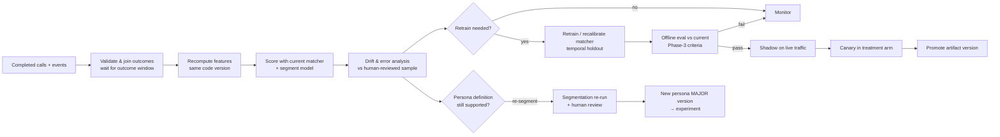

# 08 · Feedback loop

*Deliverable 9, plus brief §7.*

## 1. What is captured

Event contract: `schemas/call_event.schema.json`. Outcome contract: `schemas/outcome.schema.json`.

| Item | Where |
|---|---|
| Call / session ids, pseudonymous seller key | every event |
| Objective, experiment id, arm, exploration flag | `call_started`, `experiment` block |
| Pinned persona versions | `call_started.payload.pinned_personas` |
| Initial matching signals and every evaluation | `match_evaluated` (scores, abstained, reason, scorer, model version, latency) |
| Initial persona and every switch/revert, with trigger | `persona_committed` / `persona_switched` / `persona_reverted` (full `SwitchDecision`) |
| Explicit overrides | `style_override_applied` |
| Style actually used for each reply | `agent_turn_composed` (TTS params, overrides, stage) |
| Conversation-level interaction features | Recomputed offline from the transcript by the *same* code. Not logged per turn, to keep events small |
| Disposition, termination reason, persona history | `call_ended` |
| Downstream business outcomes | outcome records (`objective_achieved`, `downstream_conversion`, `callback_honoured`, `complaint`, `human_review`) |
| System errors, ASR quality | `matcher_fallback`; `low_confidence_turns` / `silent_turns` in `call_ended`; ASR confidence in the transcript store |

### Storage separation

| Store | Contents | Access | Retention (proposal, to confirm with legal) |
|---|---|---|---|
| Transcript store | Redacted transcripts | Restricted: analysts with purpose approval; every access audited | Shortest permitted, e.g. 90 days, then delete or aggregate |
| Derived features | Feature vectors per call + code version | Data science | 12 months |
| Predictions | Match results, segments + model version | Data science | 12 months |
| Actions | Persona events, overrides | Data science, conversation design | 12 months |
| Outcomes | Outcome records | Business analytics, data science | Per business policy |

The stores are joined only on `call_id`, and the joins run inside the warehouse. Exports contain aggregates only.

## 2. Four kinds of feedback, never conflated

| Kind | Question | Signal | Used for |
|---|---|---|---|
| **Matching** | Was the predicted segment consistent with independent evidence? | Human review of a stratified sample (≥ 50 calls/persona/month), reviewers blind to predictions; agreement with the full-call segment | Matcher accuracy, drift, retraining labels |
| **Conversation** | Did the style improve the interaction? | Clarification/repeat requests, premature hang-ups, objection resolution, interruptions **after** the persona was applied | Style iteration (persona minor versions) |
| **Business** | Did the call achieve its objective? | Outcome records, ideally from systems independent of the bot | A/B primary metric |
| **Operational** | Did adaptation cause disruption? | Latency, fallbacks, switch rate, reversals, errors, cost | Guardrails, reliability |

A converted call does **not** show that the persona was right, and a lost call does not show that it was wrong. Business outcomes are evaluated only as arm-level comparisons (doc 09), never as per-call labels for the matcher.

## 3. Learning pipeline (periodic batch)

1. **Validate and join.**
   - Wait for each outcome's observation window (e.g. 7 days for catalog updates). Calls still inside the window are excluded, never counted as failures.
   - Deduplicate on `outcome_id`.
   - Apply `supersedes` corrections.
2. **Recompute features** with the pinned code version, so features match what the live matcher computed.
3. **Evaluate existing personas.** Segment shares, prototype drift, matcher agreement with the human-reviewed sample.
4. **Assess errors and drift** (section 5).
5. **Retrain or recalibrate** only when a trigger fires: drift alarm, calibration ECE > 0.05, reviewed accuracy dropping 5 points, or a scheduled monthly run.
   - Recalibration alone is the first remedy.
   - Full retraining is the second.
6. **Revise persona definitions** only through a segmentation re-run, human review and a new MAJOR version, which then needs a new experiment.
7. **Evaluate offline** against the current production model on the same temporal holdout. Promote only if the candidate is not worse on any per-persona recall by more than 0.05 and is better on macro-F1 or ECE.
8. **Deploy gradually:** shadow → canary (10% of treatment) → full treatment. Artifacts are versioned (`model_version` on every event), and rollback means re-pinning the previous artifact.

### Batch vs incremental learning

| | Periodic batch (recommended) | Incremental / online |
|---|---|---|
| Interpretability and audit | Each model is a reviewed, versioned artifact | Model changes continuously |
| Safety | Offline eval and shadow before any effect | Bad data can degrade production within hours |
| Delayed outcomes | Waits for complete windows | Learns from incomplete, biased labels |
| Adaptation speed | Weeks | Hours |
| **When to reconsider** | — | Only once the system is proven, drift is fast, and a contextual bandit with off-policy evaluation and hard guardrails is justified |

**No production persona or model is changed automatically by an individual call.**

## 4. Preventing feedback-loop bias

| Risk | Control |
|---|---|
| The matcher only observes outcomes of its own choices | **Exploration.** In `exploration_epsilon` (5%) of treatment calls, the persona is drawn at random from the personas with probability ≥ 0.2 (never an implausible one). `is_exploration_call` is deterministic per call and logged in `experiment.exploration`. This gives off-policy data for future evaluation. *Status: the flag and schema field exist; applying it inside `CallSession` is a Phase 6 task* |
| No counterfactual after rollout | **Permanent holdout.** `holdout_share` (5%) of sellers stay on control indefinitely, so baseline drift and long-term effects stay measurable |
| Class imbalance | `class_weight="balanced"`; per-persona metrics; stratified review sampling |
| Missing / delayed labels | Observation windows; missing ≠ failure; separate metrics for coverage of outcomes |
| Selection bias (who reaches turn 3) | Persona effects are evaluated by intention-to-treat at the **arm** level, never only on calls that got a persona |
| Campaign / lead-quality confounding | Randomization in the A/B; residualization and covariates offline; analyses within campaign |
| Model drift | Section 5 |
| Label circularity (cluster labels train the matcher) | The human-reviewed sample is the external ground truth; reviewers are blind to predictions |
| Temporal leakage | Temporal splits only; test-period sellers removed from training |

## 5. Drift monitoring

| Monitor | Signal | Alert (tunable) |
|---|---|---|
| Feature drift | PSI per segment feature, weekly vs reference window | PSI > 0.2 |
| Persona mix | Share of calls committed to each persona, by campaign and language | ± 10 points vs 4-week mean |
| Abstention / coverage | Share of calls that stay neutral through turn 3 | ± 10 points |
| Calibration | ECE on the reviewed sample | > 0.05 |
| Matching quality | Accuracy vs the reviewed sample | Drop > 5 points |
| Switching health | Switches per call, revert rate, cooldown hits | Doubling vs baseline |
| Lexicon health | Tag rates per lexicon category | Sudden change usually means an ASR or script change |
| Upstream changes | Agent / script / ASR version changes | Automatic re-baseline of all monitors |
